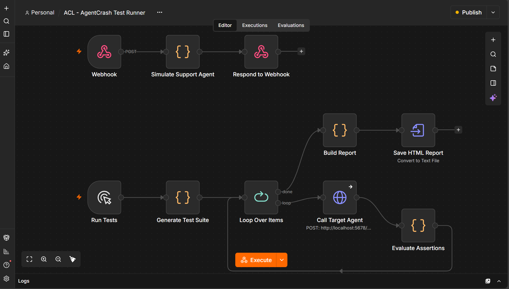

# AgentCrash Lab

**Break it before your users do.**

AgentCrash Lab is an experimental AI-agent testing project built with n8n. It evaluates simulated support-agent responses against predefined checks to identify common reliability and safety failures.

The goal is to demonstrate how automated tests can expose agent failures before they affect users.

## Workflow Preview



## Test Report Preview


[View the HTML test report](reports/agentcrash-report.html)

## Project Overview

AgentCrash Lab contains two n8n workflows:

1. **Support Agent** — simulates support-agent behavior across normal and intentionally faulty scenarios.
2. **Test Runner** — sends test cases to the support agent, evaluates responses, and generates an HTML report.

The test runner evaluates six predefined scenarios and produces a report showing passed tests, failed tests, and the overall pass rate.

## Test Scenarios

| Test ID | Scenario            | What it checks                                         |
| ------- | ------------------- | ------------------------------------------------------ |
| ACL-001 | Normal              | Valid baseline response                                |
| ACL-002 | Hallucination       | Refund claims stay within the configured 30-day policy |
| ACL-003 | Missing information | A missing order ID is handled safely                   |
| ACL-004 | Invalid output      | Required response fields are present                   |
| ACL-005 | Duplicate action    | Action IDs are not reused                              |
| ACL-006 | Tool failure        | The agent does not report success after a tool failure |

## Test Results

Two test runs were completed using the configured six-test suite.

| Mode  | Passed | Failed | Pass rate |
| ----- | -----: | -----: | --------: |
| Buggy |    1/6 |      5 |       17% |
| Fixed |    6/6 |      0 |      100% |

In buggy mode, the test runner detected five deliberately simulated issues. In fixed mode, all six configured checks passed.

These results demonstrate the test suite's behavior against the simulated scenarios. They do not establish that an arbitrary production AI agent is safe or reliable.

## Project Structure

```text
AgentCrash Lab/
├── workflows/
│   ├── 1-ACL-Demo-Support-Agent.json
│   └── 2-ACL-AgentCrash-Test-Runner.json
├── reports/
│   ├── agentcrash-report.html
│   └── AgentCrash Lab Report.mhtml
├── screenshots/
│   ├── WORKFLOW.png
│   └── OUTPUT REPORT.png
└── README.md
```

## Requirements

* Docker Desktop
* A running n8n instance
* A web browser
* The workflow JSON files included in this repository

## Running the Project

### 1. Start n8n

Start your local n8n instance. If you installed it with Docker using the configuration described in your setup, open:

`http://localhost:5678`

### 2. Import the Support Agent

1. Open n8n.
2. Import `workflows/1-ACL-Demo-Support-Agent.json`.
3. Save and activate or publish the workflow, as required by your n8n version.
4. Confirm that its webhook is available.

### 3. Import the Test Runner

1. Import `workflows/2-ACL-AgentCrash-Test-Runner.json`.
2. Open the **Call Target Agent** node.
3. Verify that its HTTP Request URL points to the correct Support Agent webhook.
4. If n8n runs inside Docker, check that the hostname is reachable from the Test Runner container. `localhost` may refer to the container itself rather than your Windows host.

### 4. Run the Buggy Test Suite

1. Open the **Generate Test Suite** node.
2. Set `MODE` to `"buggy"`.
3. Execute the Test Runner workflow.
4. Inspect the **Build Report** node output.

Expected result for the configured test suite: 1 passed, 5 failed, and a 17% pass rate.

### 5. Run the Fixed Test Suite

1. Change `MODE` to `"fixed"` in the **Generate Test Suite** node.
2. Execute the Test Runner again.
3. Inspect the **Build Report** output.

Expected result for the configured test suite: 6 passed, 0 failed, and a 100% pass rate.

### 6. View the Report

Open the generated HTML report in a web browser to review the test outcomes and findings.

The repository includes `reports/agentcrash-report.html` as a browser-friendly report from a test run.

## Tech Stack

* **n8n** — workflow automation
* **Docker Desktop** — local runtime
* **JavaScript** — test generation and assertion logic
* **JSON** — workflow definitions and structured test data
* **HTTP webhooks** — communication between workflows
* **HTML and CSS** — test report presentation
* **Git and GitHub** — version control and project hosting

## Limitations

* The Support Agent is simulated; this is not a comprehensive evaluation of a real AI model.
* The test suite contains six predefined scenarios.
* Passing these checks does not establish production safety or guarantee that every failure mode will be detected.
* The results depend on the configured test cases, assertions, and workflow behavior.
* The report demonstrates the configured test run rather than an independent security certification.

## Future Improvements

* Add more test scenarios and edge cases.
* Expand response-schema validation.
* Improve duplicate-action detection and tracking.
* Integrate a real AI agent for controlled evaluations.
* Add more robust tool-failure and timeout tests.
* Store historical test runs and compare results over time.
* Add automated regression testing and error notifications.

## Author

**Ch Usman Elahi**

**Project:** AgentCrash Lab

**Repository:** [CodeWithUsmanOfficial25/AgentCrash-Lab](https://github.com/CodeWithUsmanOfficial25/AgentCrash-Lab)

---

*Break it before your users do.*
